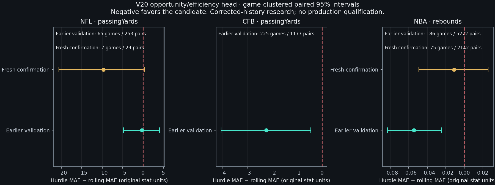
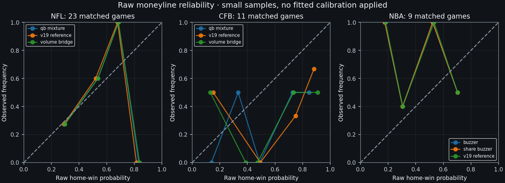

# GRIDIRON AI V20 — accuracy-first research checkpoint

Recorded November 04, 2026, 11:17 PM Eastern (2026-11-05T04:17:07.075319+00:00).

Production is unchanged. No model was promoted, no production database was queried or modified, and no paid resources or billing settings were changed. This is an implemented and executed research phase on `research/overnight-v20`, continuing V19.

The central result is conditional progress, not validated overall superiority. The opportunity/efficiency head reduced some historical mean errors. The preregistered fresh NBA confirmation did **not** establish a statistically reliable improvement. Critical point-in-time and joint-distribution gates remain unsatisfied.

## Execution, scope and stop condition

- 725 distinct games received graded player projections: 643 in the initial study and 82 in one separately locked forward confirmation. Twelve additional NFL events were audited but withheld for insufficient pregame participant history. 134,484 game/player/stat observations were graded; these are not independent games.
- Four complete-game cohort iterations, twelve point-benchmark cohort iterations, and two league-specific forward confirmation batches completed. Six point challengers per league (18 league/configuration combinations), two full-game alternatives per league (6 combinations), plus explicit baselines were examined. Windows/stat heads/seed repeats are not new architectures. One preliminary hurdle process was interrupted and retained, not counted as a completed experiment.
- 1,290,000 accepted complete-game realizations, 30,000 completed but quarantined realizations, and 21,000 diagnostic/replay realizations: **1,341,000 total**. These preceded the accuracy-first simulation pause. The point suite and forward confirmation added **zero** game simulations. No 50,000/100,000-trial batch was run merely to improve apparent precision.
- Observed campaign active time at this checkpoint: **1.563 h (5627.8 s)**. Separate conservative setup/unknown-gap budget charge: **0.650 h (2340.3 s)**. Sum charged toward the 10-hour ceiling: **2.213 h (7968.1 s)**. Unknown gaps are not reported as active computation.
- Measured CPU in completed simulation/benchmark/diagnostic/confirmation job receipts: **1923.241 seconds**. Separately reserved, not measured: 600 seconds of preflight CPU and 600 seconds for the interrupted preliminary hurdle. Source reconstruction, audits, browser tests and builds have additional CPU outside those job receipts; a complete process-tree CPU total is unavailable.
- A detached controller was actually launched and survived multiple tool calls. The environment offers no verified ten-hour survival guarantee after VM shutdown. There is no claim of inactive/background execution. The heavy queue is paused and the checkpoint is resumable.
- Stop condition: **insufficient original pregame evidence and unresolved coarsened CFB clock semantics for safe further full-game tuning**. The locked lower-cost benchmark/confirmation objectives completed. Neither the ten-hour limit nor twenty consecutive novel failed candidates was reached.

## Point-in-time evidence and selective forecasting

Every selected game and earlier-known player has a versioned evidence record covering identity, historical statistics, injuries, lineup, participation, and football weather. Original publication or a genuine immutable pre-cutoff capture is required. A provider's modification time is not silently treated as original publication. The score is source coverage, not model confidence. Unknown injury evidence never means healthy.

| League | Audited / graded initial games | Player-game evidence pairs | Verified availability pairs | Complete original pregame games |
| --- | --- | --- | --- | --- |
| CFB | 300 / 300 | 9949 | 18 | 0 |
| NBA | 261 / 261 | 7450 | 292 | 0 |
| NFL | 94 / 82 | 2207 | 0 | 0 |

NFL: 1,418 provider-timestamped injury facts were preserved but cannot certify original publication; none passes the strict original-publication availability gate. CFB: sparse official conference PDFs resolve only 18 selected player-game availability records. NBA: corrected historical PDF URL formats and column parsing resolve 292 player-game availability records in the initial study. The fresh NBA batch adds 186 source facts covering 21 games, with 106 mapped player-game availability facts. Its NFL dates have zero accessible historical report facts. No league has complete original lineup/participation/statistical-publication coverage.

Eight exact NBA trade-related ownership ambiguities were resolved from official dated transaction articles before cutoff. Thirty wrong-team zero-result grade rows were withdrawn in the **new** audit; original forecasts/grades remain intact. Ownership does not establish health, a starting role or expected minutes. Publisher metadata is not an independently captured pregame archive.

The research policy withholds unconditional forecasts when critical evidence or quantified model uncertainty is missing. Corrected-history conditional projections remain available for diagnostics. This policy is research-local and does not rewrite production predictions.

## Structural implementations and confirmed defects

1. Separate NFL/CFB/NBA opportunity-and-efficiency heads model participation/nonzero opportunity, conditional opportunity volume, and conditional yield. Fixed regularization and earlier-only fitting replace an undifferentiated statistic regression. NFL and CFB coefficients are fitted separately. These point heads do not pretend to be complete-game samples.
2. Full football candidates introduce a fitted team-volume bridge and current-season quarterback-continuity scenarios. A known-out last quarterback previously caused preflight failure before backup plans were considered. A new research-only conditional personnel planner preserves verified flags and generates only historically supported, unweighted backup scenarios. The Dallas–Philadelphia preflight now resolves one conditional scenario without reading its final box or running a new simulation. Unsupported active probabilities are not invented.
3. CFB raw training data contains 4,465 zero-elapsed positive rushes among 19,094 such rushes (23.38%). One learned conditional rush timing distribution puts 77.74% probability on zero duration. The historical official ESPN payload also repeats `15:00` across distinct rush, reception and incompletion plays. Treating these coarsened zeros as independent physical runoff can inflate plays. One event produced means 141.364 / 45.508 and 337.591 plays; its three 10,000-game outputs were quarantined. True per-snap times cannot be recovered from that source by guessing. No validated numerical clock repair is claimed.
4. NBA rebound candidates partially pool offensive/defensive rebound shares against team opportunities, exclude rebound credit for period-ending misses, and use the correct modeled period possession pattern. Team/player counts reconcile, but empirical accuracy gains are not assumed from rule fixes.
5. Five missing NBA final-box grades now use a versioned category-level reconciler. Unmapped nonzero outcomes, unknown minutes and unbalanced point totals are withheld independently; supported categories are retained. A surname-only `Olbrich` row with missing athlete identity/minutes was not guessed into a player record. Eighty-four fresh NBA forecast/stat rows remain ungraded rather than receiving fabricated values.
6. Game-level paired bootstraps preserve clustering; observation-weighted MAE deltas and their intervals use the same estimand. A separate conservative 18-comparison sensitivity analysis prevents selecting the best-looking family without qualification.
7. Runtime accounting distinguishes live processes from zombies, measured time from suspension gaps, and distinct candidates from repeated windows. Local-only checks reject unpromoted research in Vercel/Render environments. No simulations were moved into hosted request handlers.

## Benchmark suite and expected-value results

Families: rolling five-game means; opponent-adjusted rolling residuals; ridge regression; regularized player/team partial pooling; histogram gradient boosting; a regularized hybrid; and the new opportunity hurdle. The partial-pooling model is empirical regularization, not a claimed full Bayesian posterior. The matched joint simulator is reported separately on its smaller supported actor/event frame. All categories, counts, bias, RMSE and intervals are in [the CSV](overnight-v20-benchmarks.csv) and [machine-readable report](accuracy-first-v20.json).

Later chronological validation only; development window zero is excluded below. Negative paired MAE differences favor the candidate. Units are yards for football and rebounds for NBA.

| League | Primary | Games / pairs | Rolling MAE | Hurdle MAE | Rolling RMSE | Hurdle RMSE | Paired MAE delta [95%] |
| --- | --- | --- | --- | --- | --- | --- | --- |
| CFB | passingYards | 225 / 1177 | 47.910 | 45.679 | 80.065 | 72.077 | -2.231 [-4.045, -0.453] |
| NBA | rebounds | 186 / 5272 | 1.961 | 1.907 | 2.832 | 2.718 | -0.054 [-0.083, -0.025] |
| NFL | passingYards | 65 / 253 | 54.982 | 54.746 | 88.317 | 80.766 | -0.236 [-4.791, 4.080] |

CFB's pooled unadjusted interval is favorable, but window one regresses and its 18-comparison sensitivity includes no improvement. NBA's earlier mean-error signal survives that sensitivity check, but its fresh confirmation does not establish improvement. NFL's initial interval includes no improvement. No overall production qualification follows from any of these point-mean results.



## Locked forward confirmation — no retuning

Selected from metadata only after earlier results, excluding all earlier examined IDs and the 79 sealed final games. Fixed model families/hyperparameters were frozen before grading. A single fit uses only earlier data. This is fresh conditional historical confirmation, not a fully verified prospective test. No CFB games remained in the eligible forward interval before the sealed boundary, so none was substituted from the final set.

| League | Games / primary pairs | Rolling MAE | Hurdle MAE | Paired delta [95%] | Conclusion |
| --- | --- | --- | --- | --- | --- |
| NBA | 75 / 2142 | 1.882 | 1.871 | -0.011 [-0.049, 0.026] | Not established; interval includes zero |
| NFL | 7 / 29 | 54.710 | 45.036 | -9.675 [-20.652, 0.425] | Not established; interval includes zero |

NBA has 75 fresh games and 2,142 rebound observations. NFL has seven fresh games and 29 passing-yard observations. Replacing the locked primary with a better-looking secondary after seeing these outcomes would be selection bias; it was not done. No further tuning uses this confirmation set.

## Joint-game probability and interval evaluation

Accepted complete-game event counts are 23 NFL, 11 CFB and nine NBA, with three modeled variants each. These samples are far below the predeclared independent-game qualification gate. Scores, player means, Brier/log loss, CRPS and 50/80/90/95% prediction interval coverage are evaluated independently. Raw Monte Carlo hit rates are never labeled calibrated; no newly fitted calibration model or market-probability copy is used.

| League | Variant | Games | Team-score MAE | Raw Brier | Raw log loss | Raw ECE |
| --- | --- | --- | --- | --- | --- | --- |
| CFB | qb_mixture | 11 | 13.509 | 0.28126 | 0.78555 | 0.27708 |
| CFB | v19_reference | 11 | 12.448 | 0.30961 | 0.86067 | 0.36987 |
| CFB | volume_bridge | 11 | 14.320 | 0.29792 | 0.83793 | 0.34802 |
| NBA | buzzer | 9 | 7.793 | 0.27534 | 0.75669 | 0.24264 |
| NBA | share_buzzer | 9 | 7.793 | 0.27534 | 0.75669 | 0.24264 |
| NBA | v19_reference | 9 | 7.808 | 0.27328 | 0.75118 | 0.24043 |
| NFL | qb_mixture | 23 | 6.331 | 0.19385 | 0.58011 | 0.14267 |
| NFL | v19_reference | 23 | 6.694 | 0.20001 | 0.59492 | 0.14475 |
| NFL | volume_bridge | 23 | 6.352 | 0.19684 | 0.58767 | 0.14415 |

| League | Variant | Paired games | Brier delta [95%] | Score MAE delta [95%] |
| --- | --- | --- | --- | --- |
| CFB | qb_mixture | 11 | -0.028 [-0.064, 0.007] | 1.061 [-0.415, 2.915] |
| CFB | volume_bridge | 11 | -0.012 [-0.037, 0.010] | 1.872 [0.582, 3.394] |
| NBA | buzzer | 9 | 0.002 [-0.000, 0.005] | -0.015 [-0.079, 0.062] |
| NBA | share_buzzer | 9 | 0.002 [-0.000, 0.005] | -0.015 [-0.079, 0.062] |
| NFL | qb_mixture | 23 | -0.006 [-0.021, 0.006] | -0.363 [-0.883, 0.112] |
| NFL | volume_bridge | 23 | -0.003 [-0.019, 0.009] | -0.343 [-0.841, 0.112] |

CFB's quarterback mixture lowers Brier while worsening score MAE; NBA's joint candidate slightly worsens Brier/log loss. NFL directionally improves, but the paired uncertainty includes no improvement. Better mean projections alone do not validate moneylines or tails. NBA rebound point-head gains have not been proven in an independently validated joint simulation.



## Error attribution and systematic-error ranking

The implementation uses exact product/Shapley decompositions of opportunity × efficiency, and an NBA minutes-fraction × team rebound-opportunity × rebound-share decomposition. Signed and absolute-error contributions reconcile numerically. They are descriptive allocations, not causal injury/lineup effects or percentages of preventable error. Negative contributions can offset other errors.

| League / category | Supported games / actors | Mean absolute-error contributions |
| --- | --- | --- |
| CFB / passingYards | 11 / 22 | efficiency=17.240; opportunity_volume=109.296 |
| CFB / rushingYards | 11 / 179 | efficiency=7.047; opportunity_volume=12.410 |
| NBA / rebounds | 9 / 214 | playing_time_fraction=1.260; rebound_opportunity_volume=0.211; rebound_share_efficiency=0.986 |
| NFL / passingYards | 23 / 46 | efficiency=15.680; opportunity_volume=70.377 |
| NFL / receivingYards | 23 / 507 | efficiency=6.889; opportunity_volume=10.046 |
| NFL / receptions | 23 / 507 | efficiency=0.322; opportunity_volume=0.953 |
| NFL / rushingYards | 23 / 271 | efficiency=5.600; opportunity_volume=7.753 |

Separate snap time and football pace effects are not identifiable from these aggregate archives. NBA on-court missed shots are proxied by minutes; this cannot establish lineup causality. A distribution-assumption contribution to one realized mean error is unidentifiable and remains null. Distribution quality is assessed separately with proper scores and interval coverage. Player projections without supported opportunity distributions are excluded from that decomposition and retain their ordinary forecast error.

The dashboard ranks recurring bias by prior role/opportunity group, rather than presenting one extreme game as the only cause. Complete ranked groups, season results, window-specific changes and promotion rejection reasons are in the JSON report.

## Temporal integrity, markets and storage

- Four chronological cohort windows per league; window zero development and windows one–three validation. Training uses at most 500 earlier completed games with a six-hour embargo. Earlier event history can update features; this is rolling walk-forward validation, not a whole-season frozen external test.
- Existing owned archives contain outcomes, but current-game labels are not passed to feature construction or model fitting. Forecast files and model parameters are frozen before the grading stage accesses final boxes. The corrected-history/original-publication limitation remains explicit.
- Previously examined V17 metadata had 72 distinct eligible IDs despite the earlier 342 repeated evaluation rows. Their overlap with V20 selection is zero. Prior V19 evaluation IDs are excluded. The 79 reserved historical final games have zero grading/selection overlap and remain ungraded.
- A broad transaction search incidentally exposed a current Detroit–Philadelphia news result. A timestamped exclusion notice is preserved; it did not intersect V20's historical final set. The potentially affected V19 prospective window must not be represented as wholly untouched. No score was copied into V20 features.
- PropLine's documented Hobby history lookback is 30 days. These historical samples fall outside the useful range. No authenticated historical price response, exact threshold, executable quote, source timestamp or settlement rule was verified in this campaign. Unverified schedule reference lines are excluded. No betting-return/prop calibration or market ensemble is claimed, and sportsbook prices are never called DraftKings Predictions contracts. Existing integrations are preserved.
- Compact simulation records retain model/input/source versions, seed, configuration, histograms, sufficient probability summaries and a few representative games. Every simulated play is not permanently stored. Research-only immutable SQLite snapshots/outbox and backup were restart-tested; verified updates append invalidations and deduplicated bounded refresh work instead of rewriting snapshots. The new watcher/resimulation mechanism is not enabled against production; no live update-to-resimulation success is claimed.
- Supabase, MongoDB, Cloudflare, wallet/P&L and AI histories were left untouched. This phase does not claim a new cross-device production persistence test.

## Dashboard, source changes and verification

The new `/research/v20` page is statically rendered on the research branch with league filters, evidence coverage, ranked repeated misses, seven-family comparisons, raw reliability diagrams, interval coverage, attribution and separate forward confirmation. Its JSON endpoint serves cached report data. Opening the page and switching views cause no API preparation, training or simulation requests. Local production-mode Chromium tests cover desktop and iPhone-sized layouts; no physical iPhone/Safari installation or production deployment was performed.

Important source groups:

- `modeling/accuracy_v20/`: evidence policy, separate opportunity/efficiency models, exact attribution, opponent-adjusted baseline, ownership resolver, selective outcome adapter, conditional personnel, holdout integrity, immutable snapshots/outbox and promotion gates.
- `modeling/overnight_v20/` and `scripts/*v20.py`: bounded resumable research controller, league-specific joint candidates, source reconstruction, cold replay, diagnostics, point-only benchmarks, locked confirmation, cached audit/report generation.
- `components/AccuracyResearchV20.tsx`, `app/research/v20/`, `app/api/engine/route.ts`: read-only research UI and cached report.
- `modeling/test_accuracy_first_v20.py`, `modeling/test_overnight_v20.py`, `tests/accuracy-v20*`: mechanics, temporal isolation, accounting, evidence, snapshots, caching and browser regressions. Synthetic mechanics tests are not historical accuracy evidence.

```json
{
  "auditWarmCache": {
    "hit": true,
    "newSimulations": 0
  },
  "browser": {
    "durationSeconds": 3.6,
    "passed": 2,
    "physicalIPhoneOrSafariTested": false,
    "targets": [
      "desktop-chromium",
      "iPhone 13 viewport in Chromium"
    ],
    "unexpectedApiOrMutatingRequests": 0
  },
  "diffWhitespace": "passed",
  "javascript": {
    "durationSeconds": 53.18,
    "files": 115,
    "passed": 793,
    "scope": "Full local Vitest suite"
  },
  "newResearchSnapshots": {
    "productionDatabaseWrites": 0,
    "restartBackupAndInvalidation": "unit-tested",
    "storage": "isolated local SQLite"
  },
  "notExecuted": [
    "Production deployment or promotion",
    "Physical iPhone Safari installation",
    "Fresh production Supabase/Render/Vercel integration checks",
    "New model probability calibration against verified historical prop thresholds",
    "Grading or tuning on the 79 sealed historical final games"
  ],
  "productionBuild": {
    "existingWarning": "health route imports version as named export from package.json",
    "firstLoadJavaScriptKB": 108,
    "researchRoute": "static",
    "status": "passed_locally"
  },
  "python": {
    "durationSeconds": 170.004,
    "passed": 314,
    "scope": "Full local modeling unittest suite"
  },
  "recordedAt": "2026-11-05T04:11:50.067656+00:00",
  "remoteCi": {
    "earlierCheckpoint": "Actions billing/spending guard reported; no paid change or rerun",
    "latestAnnotation": "Endpoint unavailable through connector",
    "latestJobId": 127042047304,
    "latestRunId": 41965690877,
    "status": "failed_before_steps",
    "stepsExecuted": 0
  },
  "simulationWorkflow": {
    "failed": 0,
    "passed": 9
  },
  "typescript": "passed"
}
```

The production build has an existing health-route JSON named-export warning; it succeeded. The latest GitHub Actions verify job failed with no steps executed. An earlier checkpoint reported an Actions billing/spending guard; the latest annotation endpoint is unavailable through the connected tool. No successful remote CI run is claimed, and no paid setting was changed.

## Recovery, exact resume commands and promotion decision

Branch: `research/overnight-v20`; source checkpoint used to render this report: `fd8ee031bb33696bd74b2e6eb027e3c563db994d`. Public branch checkpoint mappings and verified tree hashes are maintained in `overnight-v20-publication.json` when published. Recovery branch `checkpoint/pre-v20-20261105` and all original forecasts remain available. Source and measured-result archives exclude credentials, raw vendor documents and unnecessary datasets.

From the original checkpoint workspace (source archives and hashes in the frozen protocols must match):

```sh
pip install -r modeling/requirements-overnight.txt
OPENBLAS_NUM_THREADS=1 OMP_NUM_THREADS=1 MKL_NUM_THREADS=1 \
  python scripts/research-point-only-v20.py
OPENBLAS_NUM_THREADS=1 OMP_NUM_THREADS=1 MKL_NUM_THREADS=1 \
  python scripts/run-confirmation-v20.py
OPENBLAS_NUM_THREADS=1 OMP_NUM_THREADS=1 MKL_NUM_THREADS=1 \
  python scripts/audit-accuracy-first-v20.py
python scripts/report-accuracy-v20.py
python scripts/research-overnight-v20.py --status
```

The two completed experiment commands return existing receipts; they do not repeat tuning. The audit returns a cache hit while inputs are unchanged. Full-game `continue-overnight-v20.py --slice-seconds 1800` intentionally refuses to run while `runtime/accuracy-first-pause.json` is set. Do not clear that evidence gate merely to generate more trials. A future numerical/evidence change needs a newly registered revision, fresh eligibility audit and budgets; existing snapshots and the final holdout must remain intact. Reproducing on another machine requires the private checkpoint plus the original source archives identified by SHA-256, not source code alone.

No candidate qualifies for production promotion now. NBA partial pooling/hurdle mean projections merit further research, but the locked fresh primary result is inconclusive and original pregame evidence remains inadequate. CFB needs trustworthy pace/timing and quarterback-participation evidence before safe joint-model tuning. NFL needs original historical availability and a larger independent validation sample. Production, financial records and infrastructure remain preserved.
