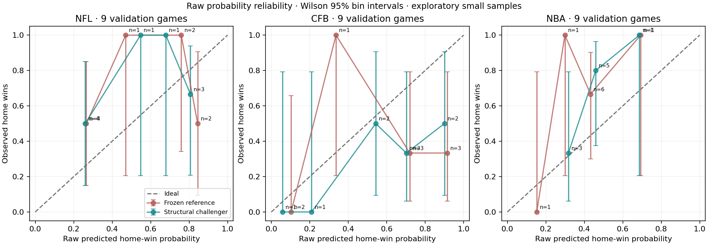
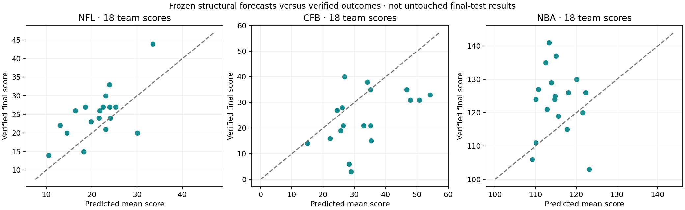

# Balanced NFL, CFB and NBA structural reconstruction — v19

This is implemented research code and a completed bounded experiment, not a production-model promotion. Original forecasts, prior grades and financial records were preserved. NFL and CFB source reconstruction and fitting started together; full-game execution alternated NFL, CFB and NBA. No heavy job ran on Vercel or Render.

## Sample and protocol

| League | Selected new IDs | Eligible point-projection games | Full-game matchups | Structural challengers | Verified complete injury/lineup games |
|---|---:|---:|---:|---:|---:|
| NFL | 32 | 32 | 9 | 3 | 0 |
| CFB | 33 | 32 | 9 | 3 | 0 |
| NBA | 36 | 36 | 9 | 2 | 0 |

The 100 eligible point-projection games exclude all previously selected v15/v16/v18 development IDs. One CFB event lacks sufficient earlier history. They are new **validation** observations, not an untouched final test. The 342 archived games are development evidence. The prospective final period beginning November 5, 2026 remains unopened and requires genuinely frozen pre-kickoff snapshots; no historical reconstruction is mislabeled prospective.

Three chronological windows per league were selected with seed 19005. Football validation is in October, November and December 2025; NBA in November 2025, January and February 2026. Training uses earlier 2024/2025 football histories and earlier NBA boxes. These are not new independent multi-season validation cohorts. Whole-game completion plus a six-hour embargo prevents partially completed games entering fitting; fitting itself also precedes the first forecast in each cohort by six hours. Rolling-origin models may legitimately use earlier-window games when forecasting later windows. All structural recipes were frozen before their corresponding results were inspected.

Compute-plan amendment: the original four full-game matchups per window became three before running comparisons, and the NBA frozen reference was explicitly added. There were 81 first-iteration runs and 18 balanced football held-out-effect runs: **99 × 10,000 = 990,000 coherent simulated games across 27 distinct events**. Three cold replays add 30,000 verification games, not new validation events. Trials were not increased to create apparent model improvement.

## Confirmed defects and implemented repairs

1. **Missing touchdown fields became false zero labels.** None of the 11,222 NFL or 42,641 CFB player records in the two affected normalized research caches contained the three touchdown fields. Frozen v18 projection/evaluation code used a zero default. Those legacy TD heads/metrics are withdrawn through a source-hash-scoped notice. This does not invalidate every unrelated live TD model or alter a wager. Original files are intact.
2. **Independent outcome reconciliation matters.** Sixty-five public final box scores (32 NFL, 33 CFB) were collected into a grading-only store, with exact event/team/player IDs. The first 1,736 independently compared player/stat TD counts all matched newly ingested source flags; every passing/receiving identity check passed. The new flag archives cover 570 NFL and 1,901 CFB games. Twenty-nine unresolved CFB game/stat categories remain unsupported instead of being filled with zero.
3. **NCAA statistical attribution differs.** Intentional clock-killing kneels/spikes belong to TEAM under the NCAA statistical manual. The new experimental football core credits modeled CFB kneels to separate team-stat actors, reconciling team rushing totals without charging the QB. No new spike-frequency model was invented. Kneel yardage remains the disclosed one-yard approximation.
4. **CFB first observation is not necessarily kickoff.** For event 401756914 (TCU–Colorado), raw firstObservedAt is midnight while the independently verified scheduled start is 23:30 UTC. The official QB row is 29 attempts/217 yards versus normalized PBP 30/231. New grades use the official box; forecasts and historical feature values are not retrospectively rewritten. An early cutoff is conservative but cannot be described as final pregame coverage.
5. **Personnel rank is not eligibility.** NFL provider depth snapshots resolve projected QB IDs for 32 selected events, but do not establish confirmed active starters. Unknown injuries remain unknown. The experimental preflight now flags a projected-vs-recent-QB conflict and returns separate unweighted scenarios; it does not invent availability probabilities or publish an unconditional qualified forecast.
6. **Training residual shrinkage suppressed uncertainty.** The initial in-sample completion heterogeneity estimate was exactly zero in all six football fits. A second predeclared estimator fits on earlier training data and estimates residual heterogeneity on a chronological 28-day training holdout. It is allowed to remain zero. The fitted game-effect SDs were positive (NFL approximately 0.21–0.30; CFB approximately 0.34–0.52 across the reported fits). These describe residual heterogeneity, not a proven causal injury effect.

## Structural models actually tested

- Separate regularized NFL/CFB state, offense, defense and participant models with six-month recency weighting; empirical-Bayes contextual clock pools and conditional scoring. Prior opportunity histories are weighted over five games. Dirichlet game-level target/carry shares preserve shared-event correlations. The held-out shared completion effect changes game dependence while retaining the marginal completion mean numerically.
- NBA remains a separate five-player, possession-based model. Recent minute/usage estimates use disjoint older player priors and the last five games. Gamma-Poisson exposure pooling is fitted on earlier player cohorts, with recency-weighted pace; points and combined statistics still arise from joint game outcomes. Missing rotations/injuries are not declared verified.
- Five frozen point-projection families are compared in every league: rolling five-game mean, ridge regression, regularized player/team partial pooling, gradient boosting, and an opportunity-times-efficiency hybrid. The hierarchical family is partial pooling, not a claim of full Bayesian posterior inference.
- A separate corrected-label Gamma-Poisson touchdown benchmark was fitted from explicit earlier source flags. It is an analytic count benchmark, not full-game Monte Carlo, not calibrated, and not a historical bet without verified prices/rules.

## Full-game results

All probabilities below are raw simulation probabilities. Brier/log loss are lower-is-better; ECE is a coarse five-bin descriptive metric with very unstable small-sample bins. Each row has nine games and 18 team-score observations. “Frozen reference” is preserved comparison code, not a champion with established superiority.

| League/model | Team-score MAE | Brier | Log loss | ECE |
|---|---:|---:|---:|---:|
| NFL / frozen_reference | 5.6681 | 0.2620 | 0.7320 | 0.2932 |
| NFL / oof_game_effect | 5.3981 | 0.2348 | 0.6633 | 0.2395 |
| NFL / team_eb | 5.4214 | 0.2383 | 0.6739 | 0.2488 |
| NFL / team_eb_frailty | 5.4572 | 0.2393 | 0.6758 | 0.2485 |
| CFB / frozen_reference | 10.5914 | 0.3507 | 0.9952 | 0.4193 |
| CFB / oof_game_effect | 11.4156 | 0.2707 | 0.7278 | 0.2511 |
| CFB / team_eb | 11.3309 | 0.2826 | 0.7612 | 0.3688 |
| CFB / team_eb_frailty | 11.3807 | 0.2867 | 0.7751 | 0.3700 |
| NBA / frozen_reference | 10.9246 | 0.2500 | 0.6868 | 0.2850 |
| NBA / recency_usage_eb | 11.0557 | 0.2296 | 0.6477 | 0.2293 |
| NBA / v18_joint_rotation | 10.8000 | 0.2398 | 0.6670 | 0.2809 |

The coin-flip Brier baseline is 0.25. The CFB challengers remain worse than this baseline on this sample. A lower score MAE does not imply better win probabilities: scoring means, margin variance and covariance differ. The CFB held-out-effect candidate reverses the prior calibration direction, but worsens score MAE by 0.8242 points and passing-yard MAE by 9.3% on the common frame; it is rejected.





## Player distributions: matched pregame comparison frame

The frame is the intersection of available pregame player identities across candidate forecasts, with the union of their nonzero pregame category support. It excludes irrelevant all-zero receiver passing rows. Final outcomes do not choose the roles. Candidate-only coverage and unmodeled actual participants are reported separately in JSON; missing distributions are never manufactured. The NFL common passing frame is 16 QB observations, while individual candidate coverage has 18. Do not compare own-support MAEs as if denominators were identical.

| League/stat | Player pairs / games | Reference MAE / RMSE | Structural MAE / RMSE | Reference → structural 90% interval coverage |
|---|---:|---:|---:|---:|
| NFL / passingAttempts | 16 / 9 | 7.983 / 11.519 | 5.741 / 7.923 | 75.0% → 81.2% |
| NFL / passingYards | 16 / 9 | 53.122 / 73.562 | 37.636 / 47.269 | 87.5% → 93.8% |
| NFL / receivingYards | 192 / 9 | 16.811 / 24.469 | 16.604 / 24.260 | 86.5% → 90.6% |
| NFL / rushingYards | 97 / 9 | 18.137 / 31.960 | 16.561 / 30.227 | 80.4% → 85.6% |
| NFL / receptions | 192 / 9 | 1.297 / 1.783 | 1.289 / 1.754 | 85.9% → 93.2% |
| CFB / passingAttempts | 18 / 9 | 13.410 / 16.899 | 14.129 / 17.902 | 50.0% → 50.0% |
| CFB / passingYards | 18 / 9 | 99.877 / 120.502 | 109.174 / 133.397 | 61.1% → 72.2% |
| CFB / receivingYards | 228 / 9 | 15.412 / 22.577 | 16.150 / 22.804 | 90.8% → 93.9% |
| CFB / rushingYards | 146 / 9 | 16.226 / 26.112 | 16.042 / 24.886 | 84.9% → 90.4% |
| CFB / receptions | 228 / 9 | 1.130 / 1.644 | 1.145 / 1.593 | 91.7% → 96.9% |
| NBA / minutes | 207 / 9 | 6.823 / 9.074 | 6.065 / 8.281 | 23.2% → 82.6% |
| NBA / points | 207 / 9 | 5.337 / 7.099 | 4.996 / 6.714 | 75.4% → 87.4% |
| NBA / rebounds | 207 / 9 | 2.116 / 2.814 | 2.243 / 2.915 | 87.0% → 90.3% |
| NBA / assists | 207 / 9 | 1.579 / 2.260 | 1.554 / 2.202 | 90.8% → 93.2% |

## Matched simple-baseline checks

These compare the exact same player/stat observations from the nine full-game events. The broader 32/32/36-game five-family results are in results-v2.json with per-category counts and paired game-bootstrap intervals.

| League/stat | Matched observations | Rolling-5 MAE | Structural simulation MAE |
|---|---:|---:|---:|
| NFL/passingYards | 16 | 63.125 | 37.636 |
| NFL/receivingYards | 192 | 17.162 | 16.604 |
| NFL/rushingYards | 97 | 15.165 | 16.561 |
| NFL/receptions | 192 | 1.277 | 1.289 |
| CFB/passingYards | 18 | 67.894 | 109.174 |
| CFB/receivingYards | 228 | 14.602 | 16.150 |
| CFB/rushingYards | 146 | 15.022 | 16.042 |
| CFB/receptions | 228 | 1.025 | 1.145 |
| NBA/minutes | 207 | 6.047 | 6.065 |
| NBA/points | 207 | 4.825 | 4.996 |
| NBA/rebounds | 207 | 2.129 | 2.243 |
| NBA/assists | 207 | 1.517 | 1.554 |

## Why errors remain

CFB passing volume is a principal failure, not a problem that extra Monte Carlo trials can solve: the structural candidate averages **34.61 attempts for its assumed QBs versus 23.67 actually recorded** across 18 candidate QB rows. Two assumed QBs recorded zero attempts and another one attempt. NFL has an analogous projected QB with 29.60 predicted attempts and zero actual. This is evidence of participation mismatch, not proof of a specific pregame injury. Later official box scores were used to diagnose, never to choose a historical starter.

The error decomposition separates predicted opportunity volume from efficiency algebraically. For positive-actual-volume CFB QBs, the reference average absolute opportunity contribution is 85.68 yards versus 53.03 yards from efficiency; the held-out-effect candidate is 92.97 versus 45.81. These components can offset and are not causal explanations. Improving completion variance while keeping a stale assumed starter and excess passing volume does not solve the mean forecast.

NBA minutes MAE improves from 6.823 to 6.065, yet the matched rolling baseline is 6.047. Points MAE improves from 5.337 to 4.996, yet rolling is 4.825; rebounds regress from 2.116 to 2.243. Examples include projected 35.07, 32.76 and 28.73 minutes with zero recorded minutes. An unavailable historical injury/rotation archive prevents a reliable diagnosis of the reason for each absence. Regularizing rates alone cannot repair missing personnel assumptions.

No historical threshold/settlement archive was verified for these events. Therefore player-stat distribution errors and moneyline outcomes are measured, but no historical prop wagering accuracy or profit is fabricated. The corrected TD benchmark evaluates a clearly specified statistic event (at least one touchdown), not a claim that a sportsbook offered that contract.

## Historical source coverage and limitations

- NFL: versioned provider depth snapshots include dates, so all 32 selected projected-QB contexts are source-resolved. The 6,068-row 2025 injury file lacks a publication timestamp; it cannot establish point-in-time injury knowledge. The 2024 file has a modification field. Snap archives were retrieved but their original publication timing/complete identity join was not certified, so they were not silently added as verified pregame features.
- CFB: none of the 33 selected games has a complete verified injury/lineup archive in this experiment. A separate official MAC report qualifies 19 player availability facts for event 401762855, using PDF metadata plus original object upload timing. It was not added to validation based on an attractive outcome. Missing defender IDs remain unresolved.
- A separate official 49ers report qualifies two NFL out facts for an earlier source-verification case. It does not make the selected cohort injury-complete.
- Original NOAA operational GFS files were retrieved by bounded byte ranges for one NFL and one CFB forecast case. All six decoded run/lead/variable/level/checksum checks passed, with object-version upload times preceding cutoff. These are original forecasts, not observed-weather/reanalysis substitutions. They are not applied to the already frozen models: a learned, validated weather response is still absent.
- The probed historical NBA official injury PDF returned HTTP 403; no access restriction was bypassed. No current roster or postgame starting-lineup field was substituted for missing pregame evidence.
- Every accepted evidence fact has a source checksum, retrieval time, publication/snapshot time and confidence status. Retrospectively acquired PBP corrections and final boxes explicitly do not establish original pregame publication. Strict fully qualified game count is zero.

## Champion decisions and stopping condition

The research registry has independent NFL/CFB/NBA player and moneyline slots, append-only checksummed decisions, compare-and-swap locking and rollback to earlier validated models. All 16 slot/challenger decisions are rejections. None changes the production registry.

The preregistered gate requires at least 200 independent games, three chronological windows, credible paired improvement, at least 90% verified availability coverage, no moneyline Brier/log-loss regression, and no important player-category regression exceeding 3%. Player-composite promotion criteria were not invented after seeing results; this is an additional reason not to promote. Small-sample bootstrap intervals are descriptive, not a multiple-testing-adjusted discovery.

The bounded loop stops with **point_in_time_data_limitation** in all six slots after the predeclared balanced comparisons. It does not endlessly sweep calibration, repeatedly tune the final test, or claim that 990,000 trials constitute 990,000 independent historical games. Further meaningful work requires timestamped historical personnel archives and independently sampled future periods. No model is declared generally superior.

## Resource and application safety

- Fitting, full-game forecasts and frozen projections: **1549.387 local process CPU seconds** (~25.82 minutes).
- Three completed exact replay simulations: **40.512 CPU seconds**. An earlier replay invocation was interrupted after its completed NFL check; unreconciled work is bounded above by the process's 100-second CPU cap. Source collection, report generation and tests are separate; no invented exact total or hosting-billing reduction is claimed.
- Main-process peak RSS: 1,520,764 KiB (~1.45 GiB). No hosted simulation requests, paid resources or financial database operations.
- New local campaign coordinator provides one process lease, persistent CPU receipts, bounded child CPU/wall limits, verified output-cache reuse, and blocks automatic retries of interrupted work pending reconciliation. Main/held-out scripts reuse frozen snapshots and refuse unsafe resumptions.
- Aggregate histograms, model/input references, seeds and a few evidence examples are saved. Every simulated play is not permanently stored. All three 10,000-game cold replays reproduced player distributions, scores, margins, totals and convergence values exactly.
- The app audit panel, public cacheable read-only API and AI research tool expose the source correction and measured results. They cannot start a simulation. Wallet, auth, PropLine, DraftKings Predictions and storage adapters were not replaced.
- No Supabase, MongoDB, R2 or financial data was migrated, deleted or reset. No unvalidated model was deployed. Production is unchanged; deployment resumption and physical iPhone installation are not claimed.

## Reproduce and inspect

Read [protocol](parallel-v19-protocol.json), [source coverage](parallel-v19-source-coverage.json), [source reconciliation](parallel-v19-source-reconciliation.json), [all numerical comparisons](parallel-v19-results-v2.json), [diagnostics](parallel-v19-diagnostics.json), [corrected TD benchmark](parallel-v19-td-benchmark.json), [six-slot decisions](parallel-v19-decisions.json), and [cold replay receipts](parallel-v19-reproducibility.json). The original result file is preserved; results-v2 adds own-support coverage and matched rolling comparisons.

Use `python -m pip install -r modeling/requirements-research.txt`, then the source ZIP and evidence ZIP in an isolated local checkout. Existing v18 evidence contains the owned earlier historical cache files referenced by protocol checksums. Do not unpickle files from an untrusted source.

```sh
export OPENBLAS_NUM_THREADS=1 OMP_NUM_THREADS=1 MKL_NUM_THREADS=1
# Completed main and OOF result files should be read/reused, not rerun.
python scripts/oof-parallel-v19.py
# For a new experiment, create a new immutable campaign/protocol; do not
# overwrite an existing report or reuse an already inspected final period.
python -m unittest modeling.test_reconstruction_v19 modeling.test_structural_v18 modeling.test_engines_v15 modeling.test_compute_policy modeling.test_engine_v15_routes
npm test
npm run typecheck
npx playwright test tests/reconstruction-v19.e2e.spec.ts
```

Official references: [nflverse update timing](https://nflreadr.nflverse.com/articles/nflverse_data_schedule.html), [NCAA statistical manual mirror](https://s3.amazonaws.com/fs.ncaa.org/Docs/stats/Stats_Manuals/Football.pdf), [MAC archived availability report](https://s3.amazonaws.com/sidearm.sites/mac-sports/documents/2025/11/8/2025_FB_Availability_Report_11_8.pdf), [NOAA GFS public archive](https://registry.opendata.aws/noaa-gfs-bdp-pds/). Source URL/hash/timestamp receipts accompany each collected document.

## Verification completed

- 786 existing JavaScript tests across 113 files, plus 3 new audit API/AI tests, passed.
- 59 targeted Python tests passed (13.188 seconds), including shared-stat accounting, NCAA team credits, personnel ambiguity, publication cutoffs, league isolation, budget/retry controls and registry gates. Full Python discovery was not run this iteration.
- Desktop Chromium and iPhone 13-sized Chromium both passed the browser → actual local research API → committed evidence → rendered table workflow, with zero POST/compute requests and no page overflow or console errors. iPhone/Safari hardware installation was not tested.
- TypeScript and optimized production build passed. An existing health-route package-version import emitted a warning.
- Local production HTTP checks returned 200 for both new public report views and 400 for an unsupported view. Browser headers remain private/no-store; CDN-specific headers separately cache only the public evidence for 300 seconds. Invalid-view errors have no shared-cache directive. This verifies header configuration locally, not a measured deployed CDN hit rate.
- [Verification details](parallel-v19-verification.json) distinguish local browser/API tests from unrun hosted database/physical device tests. [Label provenance](parallel-v19-label-provenance.json) preserves explicit missing original publication timestamps and inherited source references instead of inventing them.
